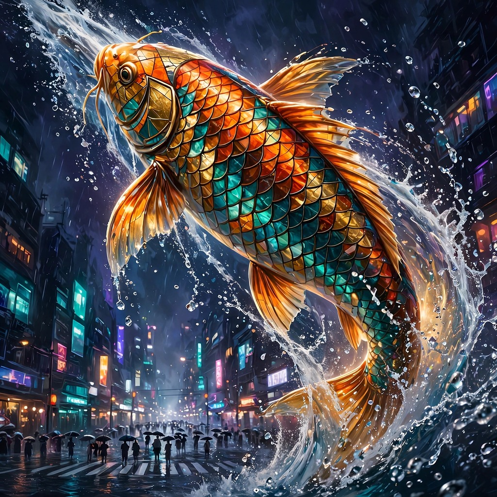

# JOLT

[](https://make.fun/bounty/ai-excited-01?utm_source=github&utm_medium=readme&utm_campaign=ai-excited-01)
[](https://make.fun/bounty/ai-excited-01/leaderboard?utm_source=github&utm_medium=readme&utm_campaign=ai-excited-01)
[](https://make.fun/bounty/ai-excited-01?utm_source=github&utm_medium=readme&utm_campaign=ai-excited-01)

An entry for the make.fun bounty [“Make the AI judge excited”](https://make.fun/bounty/ai-excited-01).



## The image

A koi the size of a building, its scales panes of stained glass in ember
orange, teal and gold, caught at the top of a leap out of a flooded neon
street at night. Water arcs off its body toward the viewer; far below, tiny
figures with umbrellas cross the street, there to make the fish enormous.

It was made to hit the judge's rubric in order: a jolt first — one huge,
saturated shape filling the frame mid-burst; surprise — a stained-glass fish
over a drowned city street is nobody's stock explosion; momentum — the whole
composition is one diagonal arc, still spraying; craft — clean panes, clean
silhouette, no text anywhere; and it reads small, because at 300 pixels the
picture is still one unmistakable orange fish against the dark.

`entry.png` holds JPEG bytes (the gate reads the magic bytes, not the name):
1024×1024, 463,418 bytes, inside the 1 MiB and 1024-pixel limits.

## Run

```sh
mkdir -p out && MAKEFUN_OUTPUT_DIR=out node main.ts
```

`main.ts` (Node 22, standard library only) copies the committed `entry.png`
to the output directory — `/output` in the grader's container,
`MAKEFUN_OUTPUT_DIR` locally — byte for byte, the same on every run.

## License

MIT — see `LICENSE`.
